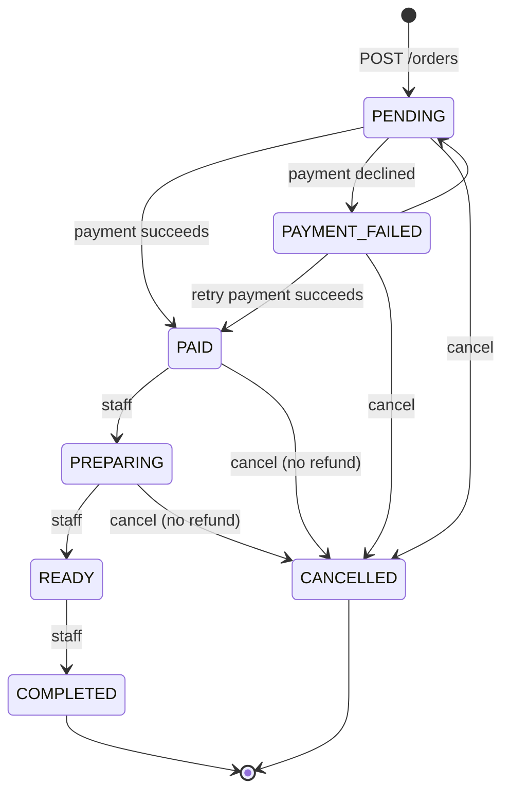

# BrewLite

Cashless coffee ordering app: browse the menu, customise a drink (size, toppings), pay from a
wallet or card (mock gateway), follow the order status and earn loyalty points. Software Engineering
assignment (Saigon University, 2026–2027).

**Stack**

- Frontend: Next.js 14 (App Router), React 18, Tailwind CSS, Zustand (cart and auth stores), Vitest
- Backend: NestJS 10 (Express), Passport JWT, class-validator, Jest + supertest
- Database: PostgreSQL 16 through Prisma 6 (migrations in `apps/backend/prisma/migrations`)
- Delivery: Docker Compose (db + backend + frontend)

## Folder structure

```
brewlite/
├── apps/
│   ├── backend/                    NestJS REST API, global prefix /api (http://localhost:4000/api)
│   │   ├── src/
│   │   │   ├── main.ts             bootstrap: prefix /api, CORS, global ValidationPipe
│   │   │   ├── app.module.ts       root module (config, Prisma, feature modules)
│   │   │   ├── config/             typed configuration + production JWT secret check
│   │   │   ├── prisma/             global PrismaModule + PrismaService
│   │   │   ├── common/             idempotency helper, decorators (current user), guards (staff key)
│   │   │   └── modules/            one folder per feature (controller, service, dto, entity)
│   │   │       ├── auth/           register / login / me, JWT strategy and guard
│   │   │       ├── users/          user lookups used by auth
│   │   │       ├── products/       GET /products, GET /products/:id
│   │   │       ├── orders/         create, quote, list, detail, cancel, staff status; order-state.ts
│   │   │       ├── payments/       mock gateway, payment idempotency, PROCESSING lock
│   │   │       └── vouchers/       voucher and loyalty pricing (pure functions, unit tested)
│   │   ├── prisma/                 schema.prisma, migrations/, seed.ts
│   │   └── test/                   e2e specs (auth, products, orders, payments, stock, vouchers)
│   └── frontend/                   Next.js App Router (http://localhost:3000)
│       ├── public/images/menu/     product photos (credits in CREDITS.md)
│       └── src/
│           ├── app/                routes: / (landing), /menu, /menu/[id], /cart, /checkout,
│           │                       /login, /register, /orders, /orders/[id]
│           ├── components/         ui/ (Button), layout/ (Navbar, Footer), landing/, shared/,
│           │                       auth/, menu/, cart/
│           ├── features/           checkout/ (payload, voucher, payment errors) and orders/ (API, views)
│           ├── content/            landing-page copy (edit text here, not in components)
│           ├── lib/                API client (api.ts), price formatting, auth helpers, safe redirect
│           └── store/              Zustand stores: cart.ts, auth.ts
├── docker/postgres/init/           creates the brewlite_test database on a fresh volume
├── docs/scrum/                     sprint plan, burndown template, Definition of Done
├── docker-compose.yml              db + backend + frontend
├── .env.example                    root variables read by docker-compose
└── package.json                    helper scripts (install:all, dev:*, build, test, docker:*)
```

The `features/auth`, `features/menu` and `features/cart` folders are empty placeholders; their code lives in
`components/auth`, `components/menu`, `components/cart` and `store/`. The backend `common/filters`,
`common/interceptors` and `common/pipes` folders are empty.

Rule of thumb: **routes in `app/`, UI pieces in `components/`, business code for one domain in `features/` (frontend) or `modules/` (backend).**

## Run locally (dev servers on the host)

Only the database runs in Docker; the API and the web app run on the host.

```bash
cp .env.example .env
cp apps/backend/.env.example apps/backend/.env   # Prisma CLI and the backend read this file
docker compose up -d db                           # Postgres 16 on localhost:5432
npm run install:all                               # installs backend and frontend dependencies
cd apps/backend && npx prisma migrate deploy && npm run prisma:seed && cd ../..
npm run dev:backend      # http://localhost:4000/api
npm run dev:frontend     # http://localhost:3000   (second terminal)
```

- `brewlite_test` is created by `docker/postgres/init/01-create-test-db.sql`, which only runs when the
  `db-data` volume is first created. For an existing volume, create it once:
  `docker compose exec db psql -U brewlite -d brewlite -c "CREATE DATABASE brewlite_test OWNER brewlite;"`
- Use `npx prisma migrate dev` instead of `migrate deploy` when you change `schema.prisma` (dev only).
- Reset the dev database (drops all data): `cd apps/backend && npx prisma migrate reset`.
- The frontend calls the API at `NEXT_PUBLIC_API_URL` (default `http://localhost:4000/api`). Override it in
  `apps/frontend/.env.local` (see `apps/frontend/.env.example`) if the backend runs elsewhere.

## Run with Docker (all three services)

```bash
cp .env.example .env
docker compose up --build          # add -d to run in the background
```

| Service | URL on the host | Notes |
| ------- | --------------- | ----- |
| frontend | http://localhost:3000 | Next.js standalone build |
| backend | http://localhost:4000/api | `prisma migrate deploy` and the seed run on every start |
| db | localhost:5432 | Postgres 16, the backend waits for its healthcheck |

- The seed upserts the 10 products and the 2 vouchers by id/code, so restarting the backend never duplicates
  them. It does reset the seeded product stock and prices to the seed values, and it keeps voucher usage counts.
- `NEXT_PUBLIC_API_URL` is baked into the frontend at build time. It must be a URL the browser can reach
  (`http://localhost:4000/api`), not a Docker-internal host name. After changing it, rebuild with `docker compose up --build`.
- The backend image runs with `NODE_ENV=production`, which refuses a missing, short (under 32 characters) or
  placeholder `JWT_SECRET`. Set your own value in `.env` for anything beyond local play.
- Stop with `docker compose down`. This keeps the `db-data` volume; `docker compose down -v` deletes the data.

## Environment variables

Names and purpose only. Put real values in the `.env` files; never commit them.

Root `.env` (read by `docker-compose.yml` for variable substitution):

| Variable | Used by | Notes |
| -------- | ------- | ----- |
| `POSTGRES_USER` | db, backend | Part of the backend `DATABASE_URL` that compose builds. |
| `POSTGRES_PASSWORD` | db, backend | Development value only. |
| `POSTGRES_DB` | db, backend | Name of the application database. |
| `JWT_SECRET` | backend | Signs access tokens. At least 32 characters; placeholders are rejected in production mode. |
| `JWT_EXPIRES_IN` | backend | Token lifetime, e.g. `1h`, `7d`. Default `1d`. |
| `CORS_ORIGIN` | backend | Browser origin allowed to call the API. Default `http://localhost:3000`. |
| `NEXT_PUBLIC_API_URL` | frontend (build arg) | API base URL seen by the browser. Default `http://localhost:4000/api`. |

Backend `apps/backend/.env` (local mode; read by the Node process and the Prisma CLI):

| Variable | Default | Notes |
| -------- | ------- | ----- |
| `PORT` | `4000` | HTTP port of the API. |
| `DATABASE_URL` | none (required) | Points at `localhost:5432` in local mode and at `db:5432` in compose. |
| `DATABASE_URL_TEST` | none | Database used only by the e2e tests (`brewlite_test`). |
| `JWT_SECRET` | `dev-secret` outside production | Required when `NODE_ENV=production`. |
| `JWT_EXPIRES_IN` | `1d` | Token lifetime, passed to `jsonwebtoken`. |
| `CORS_ORIGIN` | `http://localhost:3000` | Allowed browser origin. |
| `STAFF_API_KEY` | unset | Enables `PATCH /api/orders/:id/status`. Unset means that endpoint answers 404. Use a long random value. `docker-compose.yml` passes it from the host environment (`STAFF_API_KEY: ${STAFF_API_KEY:-}`), so it stays disabled in Docker unless you export a value before `docker compose up`. |

`apps/frontend/.env.local`: `NEXT_PUBLIC_API_URL` (see `apps/frontend/.env.example`).

The root `.env.example` also lists `DATABASE_URL` and `DATABASE_URL_TEST`. Compose does not read them: the backend URL is built from the
`POSTGRES_*` values and the ports are fixed in `docker-compose.yml`. They are informational for local runs.

## API endpoints

Base URL `http://localhost:4000/api`. Errors are JSON responses with the HTTP status; voucher errors also carry a
machine-readable `code`. All request bodies are validated (`ValidationPipe` with whitelist and forbidNonWhitelisted).

| Method | Path | Auth and headers | Responses |
| ------ | ---- | ---------------- | --------- |
| GET | `/products` | none. Optional `?category=coffee\|tea\|pastry` | 200 list; 400 for any other category |
| GET | `/products/:id` | none | 200; 404 unknown id |
| POST | `/auth/register` | none. Body `{email, password (8-72), name?}`; email is lowercased | 201 `{user, accessToken}`; 400; 409 email taken |
| POST | `/auth/login` | none. Body `{email, password}` | 200 `{user, accessToken}`; 401 (same message for unknown email or wrong password) |
| GET | `/auth/me` | `Authorization: Bearer <accessToken>` | 200 profile; 401 |
| POST | `/orders` | Bearer + `Idempotency-Key` (8-128 chars `[A-Za-z0-9_-]`, required) | 201 order; 200 with `Idempotency-Replayed: true` on replay; 400 (invalid input or voucher); 401; 404 unknown product; 409 stock short; 422 key reused with a different body |
| POST | `/orders/quote` | Bearer. Same body as `POST /orders`, writes nothing | 200 `{subtotal, discount, total, voucher, pointsToEarn}`; 400; 401; 404; 409 |
| GET | `/orders/me` | Bearer. `?page` (default 1), `?limit` (default 20, max 50) | 200 `{items, page, limit, total}`; 400 bad paging; 401 |
| GET | `/orders/:id` | Bearer | 200 order; 404 unknown or another user's order |
| POST | `/orders/:id/cancel` | Bearer | 200 order (no refund; releases stock, voucher use and points); 404 other user's order; 409 status not cancellable or payment in progress |
| PATCH | `/orders/:id/status` | `X-Staff-Key` header equal to `STAFF_API_KEY`. Body `{status: "PREPARING"\|"READY"\|"COMPLETED"}` | 200; 403 wrong or missing key; 404 when `STAFF_API_KEY` is unset; 409 invalid move |
| POST | `/payments` | Bearer + `Idempotency-Key` (required). Body `{orderId, method: "WALLET"\|"CARD", cardNumber?}`; `cardNumber` is 12-19 digits for CARD | 201 `{payment, order}`; 200 replay with `Idempotency-Replayed: true`; 402 `{reason, payment, order}` when declined; 400; 401; 404 not your order; 409 order not PENDING/PAYMENT_FAILED, or key owned by another user; 422 key reused for another order or body |

Request details:

- `POST /orders` body: `{items:[{productId, size?: "S"\|"M"\|"L", toppingIds?, qty (1-20)}], note?, voucherCode?}`.
  Totals are computed on the server from the database. `voucherCode` is trimmed and uppercased.
- Voucher errors (400 with `code`): `VOUCHER_NOT_FOUND`, `VOUCHER_EXPIRED`, `VOUCHER_MIN_SUBTOTAL`, `VOUCHER_EXHAUSTED`.
  The voucher code is part of the Idempotency-Key request hash.
- Loyalty points: `floor(total / 10000)` per PAID order, granted once; cancelling deducts them (never below 0).
- Payment amount is always the order total from the database. A PROCESSING payment older than 2 minutes is
  marked FAILED when the next payment for that order starts. A declined payment leaves the order in
  PAYMENT_FAILED, and retry is allowed from there.

## Order state machine

Source of truth: `apps/backend/src/modules/orders/order-state.ts` (`ALLOWED_TRANSITIONS`). Every status change
goes through `assertTransition`; an invalid move answers 409.



Happy path: PENDING → PAID → PREPARING → READY → COMPLETED. COMPLETED and CANCELLED are terminal.

## Stock and concurrent orders

`POST /api/orders` reserves stock inside the same `prisma.$transaction` that creates the order and its items. Each
product is reserved with an optimistic lock: `UPDATE product SET stock = stock - qty, version = version + 1 WHERE id = ? AND version = <read version> AND stock >= qty`.
Quantities are summed per product and products are locked in sorted id order. If the version changed, the request re-reads
the product and retries up to 5 times with a jittered backoff; it answers 409 when stock is short or the retries run out.
Any failure rolls back the whole transaction. A product whose stock reaches 0 is marked `available=false` in the same transaction.
Cancelling an order restores its quantities, voucher use and points in the same transaction as the CANCELLED move; the state
guard makes that happen once. PAYMENT_FAILED keeps the reservation so the retry can pay for it. An idempotent replay returns
the stored order and never reserves stock again. `test/orders-stock.e2e-spec.ts` runs 20 concurrent orders against 5 units and
expects exactly 5 successes.

## Seeded data

- Products: 10 items (coffee, tea, pastry). Drinks have sizes S / M (+5,000) / L (+10,000) and three toppings
  (Trân châu 8,000, Kem cheese 10,000, Thạch dừa 7,000). Pastries have no options. Two products (`Bạc hà đá xay`,
  `Bánh mì pate trứng`) start sold out.
- Vouchers:

| Code | Type | Value | Minimum subtotal | Max discount |
| ---- | ---- | ----- | ---------------- | ------------ |
| `BREW10` | percent | 10% | 50,000 VND | 30,000 VND |
| `WELCOME20K` | fixed | 20,000 VND | 60,000 VND | none |

## Tests

```bash
# backend unit tests (PrismaService and gateways are mocked; no database needed)
cd apps/backend && npm test

# backend e2e tests (needs the db container; migrates and seeds brewlite_test in beforeAll)
docker compose up -d db
cd apps/backend && npm run test:e2e

# backend production build (prisma generate + nest build)
cd apps/backend && npm run build

# frontend type check, unit tests, production build
cd apps/frontend && npx tsc --noEmit && npm test && npm run build
```

From the repo root, `npm test` runs the backend unit tests. `npm test`, `npm run build` and `npm run test:e2e` in the
backend run `prisma generate` first.

## Demo script (end to end)

Prerequisites: stack running (Docker or local dev servers), database seeded.

1. Open http://localhost:3000 and go to **Register**. Create an account (email, password of 8+ characters).
   You are redirected to `/menu`.
2. On **Menu**, filter by category if you like and open a drink such as **Cà phê sữa đá**.
3. Pick a size (M) and one or two toppings, then **Add to cart**. The navbar badge updates.
4. Add a second drink so the subtotal reaches 50,000 VND (needed for `BREW10`). Open **Cart**.
5. Go to **Checkout**. Enter voucher `BREW10`; the discount and total come from `POST /orders/quote`.
   Keep the payment method **Wallet** and pay. The order is created and paid, and you land on
   `/orders/<id>?paid=1` (order confirmation with status PAID and the loyalty points earned).
6. Open **Orders** to see the history. Use the order detail page to follow the status.

Failure demo:

1. Add a drink again (subtotal at least 60,000 VND for `WELCOME20K`, or any amount without a voucher).
2. In **Checkout**, choose **Card** and enter a number ending in `0000`, for example `4111 1111 1111 0000`.
3. The payment is declined (402). The order is PAYMENT_FAILED and the cart is kept. Switch to Wallet (or another
   card that does not end in 0000) and pay to complete the retry.

## Test hints

- Card: any CARD number of 12-19 digits that ends in `0000` is declined by the mock gateway; any other number succeeds.
- Wallet: succeeds unless the order total is above 5,000,000 VND.
- Mock payments take about 200 ms outside the test environment.

## Known limitations

- **Mock payment.** No real gateway, no refunds. Cancelling a PAID order does not return money.
- **Token in localStorage.** The access token and user profile are stored under `brewlite-auth` in `localStorage`
  so sessions survive reloads. Any script on the page can read it (XSS risk). Acceptable for this coursework;
  an httpOnly cookie would be the production choice. A 401 from the API clears the session.
- **No staff UI.** Staff advance orders only through `PATCH /api/orders/:id/status` with `X-Staff-Key`, and that
  endpoint is disabled unless `STAFF_API_KEY` is set (Docker compose passes it from the host env and leaves it empty by default).
- **Development secrets.** The default database password and JWT secret in the compose files are development values.
- **Idempotency is per user and per key.** Keys live in the database; there is no cleanup job.

## Frontend authentication

- Login and register accept `?next=` only for same-origin relative paths; anything else falls back to `/menu`.
- Pages that need a login redirect to `/login` (`use-require-auth` hook and `require-auth` component).

## Design system

Colors, fonts and tokens are in `apps/frontend/src/app/globals.css` and `tailwind.config.ts`
(Playfair Display + DM Sans, espresso / amber / cream). Landing images are placeholders until files are
added to `public/images` and passed as `src` to `ImageFrame`.

Menu photos: Unsplash, credits in [apps/frontend/public/images/menu/CREDITS.md](apps/frontend/public/images/menu/CREDITS.md).

## Git workflow

One branch per task (for example `feat/task-02-products-api`), small commits, review before merging to `main`.
The task-to-branch map is in [docs/scrum/sprint-plan.md](docs/scrum/sprint-plan.md).
