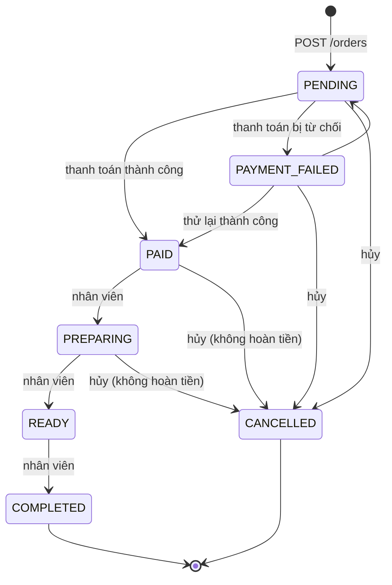

# BrewLite

Ứng dụng đặt cà phê không dùng tiền mặt. Người dùng xem menu, chọn đồ uống (size, topping), thanh toán bằng ví hoặc thẻ (cổng thanh toán giả lập), theo dõi trạng thái đơn và tích điểm. Đây là bài tập môn Công nghệ phần mềm, Đại học Sài Gòn, năm học 2026–2027.

## Công nghệ

| Phần | Công nghệ |
| ---- | --------- |
| Giao diện (frontend) | Next.js 14, React 18, Tailwind CSS, Zustand, Vitest |
| Máy chủ (backend) | NestJS 10, Passport JWT, class-validator, Jest |
| Cơ sở dữ liệu | PostgreSQL 16 qua Prisma 6 |
| Triển khai | Docker Compose (db + backend + frontend) |

## Cấu trúc thư mục

```
brewlite/
├── apps/
│   ├── api/          API NestJS, địa chỉ http://localhost:4000/api
│   │   ├── src/modules/   mỗi tính năng một thư mục: auth, users, products, orders, payments, vouchers
│   │   ├── prisma/        schema, migrations, seed (dữ liệu mẫu)
│   │   └── test/          test e2e
│   └── web/          Next.js, địa chỉ http://localhost:3000
│       └── src/
│           ├── app/          các trang (route)
│           ├── components/   các khối giao diện
│           ├── features/     checkout và orders
│           ├── content/      nội dung chữ của trang chủ
│           ├── lib/          gọi API, định dạng giá, hàm hỗ trợ đăng nhập
│           └── store/        giỏ hàng và đăng nhập (Zustand)
├── docker/           script tạo database test
├── docs/
│   ├── requirements/ bối cảnh, phạm vi, SRS, use-case
│   ├── diagrams/     activity, sequence, class
│   ├── architecture/ kiến trúc, ADR, sơ đồ triển khai
│   ├── process/      quy trình Git, quy ước commit, Definition of Done, Product Backlog
│   ├── scrum/        kế hoạch sprint, burndown, Definition of Done, đề bài PDF
│   ├── deployment.md, release-notes.md, traceability-matrix.md
├── tests/            test tích hợp và end-to-end qua HTTP (npm run test:system)
├── .github/workflows/ CI và CD (chưa chạy trên GitHub)
├── docker-compose.yml
└── .env.example
```

## Cách chạy trên máy (dev)

Chỉ database chạy trong Docker. API và web chạy trực tiếp trên máy.

```bash
cp .env.example .env
cp apps/api/.env.example apps/api/.env
docker compose up -d db
npm run install:all
cd apps/api && npx prisma migrate deploy && npm run prisma:seed && cd ../..
npm run dev:backend      # http://localhost:4000/api
npm run dev:frontend     # http://localhost:3000 (mở terminal thứ hai)
```

Lưu ý:
- Database `brewlite_test` chỉ được tạo tự động khi volume mới. Nếu volume đã có sẵn, tạo thủ công:
  `docker compose exec db psql -U brewlite -d brewlite -c "CREATE DATABASE brewlite_test OWNER brewlite;"`
- Khi sửa `schema.prisma`, dùng `npx prisma migrate dev` thay cho `migrate deploy`.
- Xóa sạch dữ liệu dev: `cd apps/api && npx prisma migrate reset`.
- Nếu backend chạy ở địa chỉ khác, đặt `NEXT_PUBLIC_API_URL` trong `apps/web/.env.local`.

## Cách chạy bằng Docker (cả 3 dịch vụ)

```bash
cp .env.example .env
docker compose up --build
```

| Dịch vụ | Địa chỉ | Ghi chú |
| ------- | ------- | ------- |
| frontend | http://localhost:3000 | Bản build Next.js |
| backend | http://localhost:4000/api | Mỗi lần khởi động đều chạy migrate và seed |
| db | localhost:5432 | Backend chờ db sẵn sàng mới chạy |

- Seed chạy lại nhiều lần không bị trùng dữ liệu, nhưng sẽ đặt lại tồn kho và giá về giá trị mẫu.
- `NEXT_PUBLIC_API_URL` được gắn vào frontend lúc build, nên phải là địa chỉ trình duyệt truy cập được (`http://localhost:4000/api`). Đổi giá trị này thì build lại bằng `docker compose up --build`.
- Ở chế độ production, backend từ chối `JWT_SECRET` thiếu, ngắn hơn 32 ký tự hoặc còn là giá trị mẫu. Hãy đặt giá trị riêng trong `.env`.
- Dừng: `docker compose down` (giữ dữ liệu). `docker compose down -v` sẽ xóa luôn dữ liệu.

## Biến môi trường

Không commit giá trị thật. Chỉ ghi vào file `.env`.

File `.env` ở thư mục gốc (docker-compose đọc):

| Biến | Dùng cho | Ý nghĩa |
| ---- | -------- | ------- |
| `POSTGRES_USER`, `POSTGRES_PASSWORD`, `POSTGRES_DB` | db, backend | Tài khoản và tên database |
| `JWT_SECRET` | backend | Khóa ký token, tối thiểu 32 ký tự |
| `JWT_EXPIRES_IN` | backend | Thời hạn token, ví dụ `1h`, `7d` (mặc định `1d`) |
| `CORS_ORIGIN` | backend | Địa chỉ web được gọi API (mặc định `http://localhost:3000`) |
| `GOOGLE_CLIENT_ID` | backend | Không bắt buộc. Để trống thì tắt đăng nhập Google (trả 404) |
| `NEXT_PUBLIC_API_URL` | frontend | Địa chỉ API mà trình duyệt gọi |
| `NEXT_PUBLIC_GOOGLE_CLIENT_ID` | frontend | Không bắt buộc. Để trống thì ẩn nút Google. Phải trùng `GOOGLE_CLIENT_ID` của backend |

File `apps/api/.env` (khi chạy trên máy):

| Biến | Mặc định | Ý nghĩa |
| ---- | -------- | ------- |
| `PORT` | `4000` | Cổng của API |
| `DATABASE_URL` | bắt buộc | Địa chỉ database |
| `DATABASE_URL_TEST` | không có | Database riêng cho test e2e (`brewlite_test`) |
| `JWT_SECRET`, `JWT_EXPIRES_IN`, `CORS_ORIGIN`, `GOOGLE_CLIENT_ID` | như trên | Giống bảng trên |
| `STAFF_API_KEY` | không có | Bật API đổi trạng thái đơn của nhân viên. Không đặt thì API này trả 404. Dùng chuỗi ngẫu nhiên dài |

## Đăng nhập bằng Google (tùy chọn)

1. Tạo OAuth Client ID loại **Web application** trên Google Cloud Console.
2. Thêm `http://localhost:3000` vào **Authorized JavaScript origins**.
3. Điền cùng một Client ID vào `GOOGLE_CLIENT_ID` (backend) và `NEXT_PUBLIC_GOOGLE_CLIENT_ID` (frontend), rồi chạy lại cả hai.
4. Nút "Đăng nhập với Google" sẽ hiện ở trang đăng nhập và đăng ký.

Nếu email Google đã có tài khoản thì hai bên được liên kết. Nếu chưa có thì tạo tài khoản mới. Tài khoản chỉ có Google thì không đăng nhập bằng mật khẩu được.

## Danh sách API

Địa chỉ gốc: `http://localhost:4000/api`. Lỗi trả về JSON kèm mã HTTP. Mọi dữ liệu gửi lên đều được kiểm tra hợp lệ.

| Method | Đường dẫn | Yêu cầu | Kết quả |
| ------ | --------- | ------- | ------- |
| GET | `/products` | Không. Có thể thêm `?category=coffee\|tea\|pastry` | 200; 400 nếu category sai |
| GET | `/products/:id` | Không | 200; 404 nếu không có |
| POST | `/auth/register` | Body `{email, password (8-72 ký tự), name?}` | 201 `{user, accessToken}`; 400; 409 email đã dùng |
| POST | `/auth/login` | Body `{email, password}` | 200; 401 |
| POST | `/auth/google` | Body `{idToken}` | 200; 401 token sai hoặc email chưa xác minh; 404 nếu chưa bật Google |
| GET | `/auth/me` | `Authorization: Bearer <token>` | 200; 401 |
| POST | `/orders` | Bearer + header `Idempotency-Key` (8-128 ký tự `A-Z a-z 0-9 _ -`, bắt buộc) | 201 tạo đơn; 200 nếu gửi lại cùng key; 400; 401; 404; 409 hết hàng; 422 cùng key nhưng nội dung khác |
| POST | `/orders/quote` | Bearer. Cùng body với `POST /orders`, không ghi gì vào database | 200 `{subtotal, discount, total, voucher, pointsToEarn}` |
| GET | `/orders/me` | Bearer. `?page` (mặc định 1), `?limit` (mặc định 20, tối đa 50) | 200 `{items, page, limit, total}` |
| GET | `/orders/:id` | Bearer | 200; 404 nếu không phải đơn của bạn |
| POST | `/orders/:id/cancel` | Bearer | 200 (không hoàn tiền, trả lại tồn kho, voucher và điểm); 409 nếu không thể hủy |
| PATCH | `/orders/:id/status` | Header `X-Staff-Key` = `STAFF_API_KEY`. Body `{status: "PREPARING"\|"READY"\|"COMPLETED"}` | 200; 403 sai key; 404 chưa bật; 409 chuyển trạng thái không hợp lệ |
| POST | `/payments` | Bearer + `Idempotency-Key`. Body `{orderId, method: "WALLET"\|"CARD", cardNumber?}`, thẻ gồm 12-19 chữ số | 201; 402 bị từ chối; 409; 422 |

Chi tiết:
- Body của `POST /orders`: `{items:[{productId, size?: "S"|"M"|"L", toppingIds?, qty (1-20)}], note?, voucherCode?}`. Tổng tiền luôn do server tính từ database.
- Lỗi voucher (400 kèm `code`): `VOUCHER_NOT_FOUND`, `VOUCHER_EXPIRED`, `VOUCHER_MIN_SUBTOTAL`, `VOUCHER_EXHAUSTED`.
- Điểm thưởng: mỗi đơn đã thanh toán được `floor(tổng tiền / 10.000)` điểm, chỉ cộng một lần. Hủy đơn thì trừ lại (không xuống dưới 0).
- Số tiền thanh toán luôn lấy từ tổng đơn trong database. Giao dịch ở trạng thái PROCESSING quá 2 phút sẽ bị đánh dấu FAILED khi có lần thanh toán tiếp theo. Thanh toán bị từ chối thì đơn chuyển sang PAYMENT_FAILED và được thử lại.

## Trạng thái đơn hàng

Mọi thay đổi trạng thái đều đi qua `assertTransition` trong `apps/api/src/modules/orders/order-state.ts`. Chuyển sai thì trả 409.



Luồng bình thường: PENDING → PAID → PREPARING → READY → COMPLETED. COMPLETED và CANCELLED là trạng thái cuối.

## Tồn kho và đặt hàng đồng thời

Khi tạo đơn, tồn kho được giữ chỗ trong cùng một transaction với việc tạo đơn. Mỗi sản phẩm dùng khóa lạc quan (cột `version`): chỉ trừ kho khi `version` chưa đổi và còn đủ hàng. Nếu `version` đã đổi, hệ thống đọc lại và thử lại tối đa 5 lần. Hết hàng hoặc hết lượt thử thì trả 409 và hoàn tác toàn bộ. Sản phẩm về 0 sẽ tự đặt `available=false`.

Hủy đơn trả lại tồn kho, voucher và điểm trong cùng một transaction. Gửi lại cùng `Idempotency-Key` chỉ trả về đơn cũ, không giữ thêm hàng. Test `orders-stock.e2e-spec.ts` chạy 20 đơn cùng lúc cho 5 sản phẩm và kỳ vọng đúng 5 đơn thành công.

## Dữ liệu mẫu

- 10 sản phẩm (cà phê, trà, bánh). Đồ uống có size S / M (+5.000) / L (+10.000) và 3 topping: Trân châu 8.000, Kem cheese 10.000, Thạch dừa 7.000. Bánh không có tùy chọn. Hai sản phẩm `Bạc hà đá xay` và `Bánh mì pate trứng` ban đầu hết hàng.
- Voucher:

| Mã | Loại | Giá trị | Đơn tối thiểu | Giảm tối đa |
| -- | ---- | ------- | ------------- | ----------- |
| `BREW10` | Phần trăm | 10% | 50.000đ | 30.000đ |
| `WELCOME20K` | Cố định | 20.000đ | 60.000đ | Không giới hạn |

## Chạy test

```bash
# test đơn vị backend (không cần database)
cd apps/api && npm test

# test e2e backend (cần container db)
docker compose up -d db
cd apps/api && npm run test:e2e

# build backend
cd apps/api && npm run build

# frontend: kiểm tra kiểu, test, build
cd apps/web && npx tsc --noEmit && npm test && npm run build
```

Từ thư mục gốc, `npm test` chạy test đơn vị của backend.

## Kịch bản demo

Điều kiện: hệ thống đang chạy và đã seed dữ liệu.

1. Mở http://localhost:3000, vào **Đăng ký**, tạo tài khoản (mật khẩu từ 8 ký tự). Bạn sẽ được chuyển tới `/menu`.
2. Ở **Menu**, lọc theo loại nếu muốn, mở một món như **Cà phê sữa đá**.
3. Chọn size M và một hai topping, bấm **Thêm vào giỏ**. Số trên biểu tượng giỏ hàng tăng lên.
4. Thêm món thứ hai để tạm tính đạt 50.000đ (đủ điều kiện dùng `BREW10`). Mở **Giỏ hàng**.
5. Vào **Thanh toán**, nhập voucher `BREW10`, giữ phương thức **Ví** và thanh toán. Bạn được chuyển tới `/orders/<id>?paid=1` với trạng thái PAID và số điểm nhận được.
6. Mở **Đơn hàng** để xem lịch sử và theo dõi trạng thái.

Demo thanh toán thất bại:

1. Thêm món vào giỏ lại.
2. Ở **Thanh toán**, chọn **Thẻ** và nhập số kết thúc bằng `0000`, ví dụ `4111 1111 1111 0000`.
3. Thanh toán bị từ chối (402), đơn chuyển sang PAYMENT_FAILED và giỏ hàng được giữ. Đổi sang Ví hoặc số thẻ khác để thanh toán lại.

## Gợi ý khi test

- Thẻ 12-19 chữ số kết thúc bằng `0000` bị cổng giả lập từ chối. Các số khác thành công.
- Ví thành công, trừ khi tổng đơn trên 5.000.000đ.
- Thanh toán giả lập mất khoảng 200 ms (ngoài môi trường test).

## Hạn chế đã biết

- **Thanh toán giả lập.** Chưa có cổng thật và chưa hoàn tiền. Hủy đơn đã thanh toán không trả lại tiền.
- **Token lưu trong localStorage.** Token và thông tin người dùng lưu dưới khóa `brewlite-auth` để giữ đăng nhập khi tải lại trang. Script độc hại trên trang có thể đọc được (rủi ro XSS). Chấp nhận được cho bài tập, bản thật nên dùng cookie httpOnly. API trả 401 thì phiên bị xóa.
- **Chưa có giao diện cho nhân viên.** Nhân viên chỉ đổi trạng thái đơn qua `PATCH /api/orders/:id/status` với `X-Staff-Key`. Trong Docker, API này mặc định tắt trừ khi bạn export `STAFF_API_KEY` trước khi chạy.
- **Bí mật mặc định chỉ để dev.** Mật khẩu database và `JWT_SECRET` mặc định trong compose chỉ dùng khi phát triển.
- **Idempotency theo từng người dùng và từng key.** Key lưu trong database, chưa có job dọn dẹp.

## Đăng nhập trên giao diện

- Trang đăng nhập và đăng ký chỉ chấp nhận `?next=` là đường dẫn nội bộ. Giá trị khác sẽ quay về `/menu`.
- Trang cần đăng nhập sẽ tự chuyển về `/login`.

## Thiết kế giao diện

Màu, font và token nằm trong `apps/web/src/app/globals.css` và `tailwind.config.ts` (Playfair Display + DM Sans, tông nâu espresso, hổ phách, kem). Ảnh menu lấy từ Unsplash, nguồn ghi trong [apps/web/public/images/menu/CREDITS.md](apps/web/public/images/menu/CREDITS.md). Ảnh trang chủ ghi nguồn trong [apps/web/public/images/landing/CREDITS.md](apps/web/public/images/landing/CREDITS.md).

## Quy trình Git

Mỗi task một nhánh (ví dụ `feat/task-02-products-api`), commit nhỏ, review trước khi gộp vào `main`. Bảng task và nhánh nằm ở [docs/scrum/sprint-plan.md](docs/scrum/sprint-plan.md).
